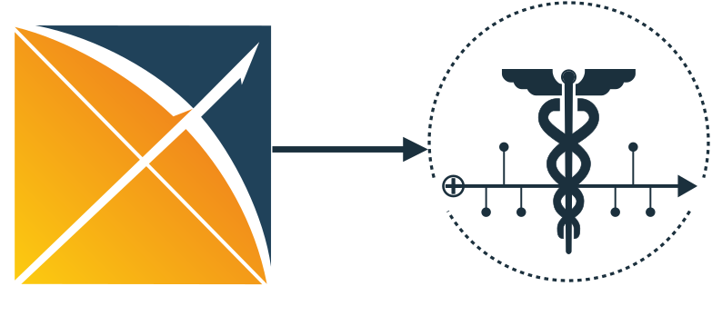

<div align="center">
  
</div>

# MEDS OMOP ETL

[](https://pypi.org/project/OMOP_MEDS/)
[](https://codecov.io/gh/rvandewater/OMOP_MEDS)
[](https://github.com/rvandewater/OMOP_MEDS/actions/workflows/tests.yml)
[](https://github.com/rvandewater/OMOP_MEDS/actions/workflows/code-quality-main.yaml)

[](https://github.com/rvandewater/OMOP_MEDS#license)
[](https://github.com/rvandewater/OMOP_MEDS/pulls)
[](https://github.com/rvandewater/OMOP_MEDS/graphs/contributors)
[](https://doi.org/10.5281/zenodo.19398854)
[](https://medical-event-data-standard.github.io/)

An ETL pipeline for transforming Observational Medical Outcomes Partnership (OMOP) Common Data Model (CDM)
datasets into MEDS using MEDS-Extract.
We gratefully acknowledge the developers of the first OMOP MEDS ETL, from which we took inspiration,
which can be found here: https://github.com/Medical-Event-Data-Standard/meds_etl.

We support OMOP CDM 5.3, 5.4 and 5.5 datasets (see [OMOP CDM versions](#omop-cdm-versions)). Earlier versions
might work but are not tested and are perhaps (?) not used in practice anymore. Please open pull requests if you
want to add support for earlier versions.

- More information about OMOP can be found here: https://ohdsi.github.io/CommonDataModel/
- More information about MEDS can be found here: https://medical-event-data-standard.github.io/

For reading in OMOP in the right schema, we use the `omop-schema` package (developed for this ETL but can be used
elsewhere), which can be found here:
https://github.com/rvandewater/omop_schema.
It holds the table schemas of OMOP CDM 5.3, 5.4 and 5.5, checked against the official CDM specification, and
reads the input tables (`omop_schema.scan.scan_table`):

- CSV, gzipped CSV and Parquet files, and directories of their shards, are supported.
- Column names are lowercased before the schema is applied, so uppercase headers (as SQL Server exports write them)
    get their types.
- Columns outside the schema, such as the `xtn_note_last_edit_*` columns notes need for leakage-safe times, are
    kept, also when a table is a directory of Parquet shards.
- DATE columns written with a midnight time (`2005-05-07 00:00:00`) are read as dates.
- Values must fit their OMOP type in CSV files and single Parquet files. Directories of Parquet shards are cast
    permissively (a value that does not fit becomes null), and every schema column is added to them, because
    large exports drift in type from shard to shard.

If your OMOP schema is non-standard (but still approximately OMOP), you should be able to use the `omop-schema` package to define your own schema and use it in this ETL.

## Setup

Requires Python `>=3.11.4,<3.14`, the range MEDS-Extract 0.8 supports: its Hydra command line fails on Python 3.14
([MEDS_extract#248](https://github.com/mmcdermott/MEDS_extract/issues/248)), and its archive extraction on 3.11.0–3.11.3
([MEDS_extract#217](https://github.com/mmcdermott/MEDS_extract/issues/217)). The MEDS conversion runs on MEDS-Extract 0.8
and MEDS-Transforms 0.7.

First install the package:

```bash
pip install OMOP_MEDS
```

Then:

```bash
export DATASET_NAME="Your_OMOP_Dataset_Name" # e.g. MIMIC_IV_OMOP
export OMOP_VERSION="5.3" # 5.3, 5.4 or 5.5
export RAW_INPUT_DIR="path/to/your/input"
export ROOT_OUTPUT_DIR="/path/to/your/output"
OMOP_MEDS raw_input_dir=$RAW_INPUT_DIR root_output_dir=$ROOT_OUTPUT_DIR
```

To try with the MIMIC-IV OMOP demo dataset (this downloads a version to your local machine), you can run:

```bash
OMOP_MEDS raw_input_dir=path/to/your/input root_output_dir=/path/to/your/output do_download=True ++do_demo=True
```

The demo is fetched as PhysioNet's project zip (~11 MB instead of ~70 MB of uncompressed CSVs) and only its
`1_omop_data_csv` folder is extracted. The archive is cached in `~/.cache/OMOP_MEDS` (override with
`download_cache_dir=...` or the `OMOP_MEDS_CACHE_DIR` environment variable) and reused for
`download_cache_max_age_days` (default 7) days; set `download_cache_dir=null` to always download. Only the public
demo is cached: credentialed datasets are never copied into the cache.

Example config for an OMOP dataset:

```yaml
dataset_name: MIMIC_IV_OMOP
raw_dataset_version: 1.0
omop_version: 5.3

urls:
  dataset:
    - https://physionet.org/content/mimic-iv-demo-omop/0.9/
    - url: EXAMPLE_CONTROLLED_URL
      username: ${oc.env:DATASET_DOWNLOAD_USERNAME}
      password: ${oc.env:DATASET_DOWNLOAD_PASSWORD}
  demo:
    - https://physionet.org/content/mimic-iv-demo-omop/0.9/
  common:
    - EXAMPLE_SHARED_URL # Often used for shared metadata files
```

Run this with:

```bash
OMOP_MEDS ++DATASET_CFG=your_config.yaml raw_input_dir=path/to/your/input root_output_dir=/path/to/your/output \
do_download=True
```

## Differences with the original meds_etl_omop

This package is designed as a more flexible and configurable alternative to the original `meds_etl_omop` package.
We make a few important choices that have impact on your downstream training and task definitions:

- We use the mapped concepts by default, which are more standardized across datasets and, for large, health systems can
    be more clean, especially if you are working with a limited tokenizer on a large dataset.
    You can still use the source concepts by setting `++prefer_source=True`.
- We use more tables than in the original `meds_etl_omop` package, which can lead to more complete patient histories.
    Watch for potential information leakage. You can change your table configs in
    `configs/pre_MEDS/omop_<version>.yaml` and `event_configs.yaml`.
- This package is more resource intensive, please adjust your `n_shards` and watch your memory usage.

## Different package versions

We have different versions of the ETL pipeline, which are designed for different use cases:

```bash
pip install OMOP_MEDS[dev] # for development and testing
pip install OMOP_MEDS[tests] # for running tests
pip install OMOP_MEDS[local_parallelism] # for local parallelization with hydra-joblib-launcher
pip install OMOP_MEDS[slurm_parallelism] # for parallelization with slurm using hydra-submitit-launcher
pip install OMOP_MEDS[large_data] # for handling large datasets with polars (rt64), more than 3.2B rows
pip install OMOP_MEDS[athena] # for the optional Athena fallback of the code metadata (suMEDS)
```

Run routine tests (skipping the two end-to-end tests that download data; drop `-m` to run everything):

```bash
pytest -q -m 'not physionet and not synthea'
```

The two end-to-end tests run the full ETL over downloaded data:

- `pytest -m synthea` uses OHDSI's [Synthea27Nj](https://github.com/OHDSI/EunomiaDatasets) sample: 28 synthetic
    subjects in OMOP CDM 5.4 (Apache-2.0), pinned and SHA-256 verified, cached in `~/.cache/OMOP_MEDS/test-data`
    (override with `SYNTHEA_OMOP_CACHE_DIR`). CI runs it in its own job on every pull request.
- `pytest -m physionet` downloads the MIMIC-IV OMOP demo (OMOP CDM 5.3) from PhysioNet. CI runs it on pushes to
    `main`, nightly and on demand, but not on pull requests, because PhysioNet is slow and unreliable from CI
    runners.

## Pre-MEDS settings

The following settings can be used to configure the pre-MEDS steps.

```bash
OMOP_MEDS \
	root_output_dir=/sc/arion/projects/hpims-hpi/projects/foundation_models_ehr/cohorts/meds_debug/small_demo \
	raw_input_dir=/sc/arion/projects/hpims-hpi/projects/foundation_models_ehr/cohorts/full_omop \
	do_download=False ++do_overwrite=True ++limit_subjects=50
```

- `root_output_dir`: Set the root output directory.
- `raw_input_dir`: Path to the raw input directory.
- `do_download`: Set to `False` to skip downloading the dataset.
- `download_cache_dir`: Where the demo download is cached (`null` disables caching; demo only).
- `download_cache_max_age_days`: How many days a cached demo download is reused (default 7).
- `++do_overwrite`: Set to `True` to overwrite existing files.
- `++limit_subjects`: Limit the number of subjects to process.
- `++prefer_source`: Set to `True` to prefer source concepts over mapped concepts.
- `++join_on_visit`: Set to `True` to join person table on having any associated visits.
- `++process_notes`: Set to `True` to .
- `athena_csv_dir`: Optional local OHDSI Athena download used as a fallback for the code metadata (see
    [Code metadata](#code-metadata-codesparquet)).

Pre-meds batching settings. This is relevant if (some of) your input tables are very large, and you want to process
them in batches. This can be useful to reduce memory usage, but it also increases the runtime, so use with caution.
The batching settings are as follows:

- `++pre_meds_chunked_tables`: Tables eligible for batched pre-MEDS processing.
- `++pre_meds_batching_row_threshold`: Row count threshold for batching.
- `++pre_meds_batch_mode`: `auto`, `per_shard`, `by_shards`, or `by_rows`.
- `++pre_meds_batch_size_shards`: Shards per batch in `by_shards` mode.
- `++pre_meds_batch_input_rows`: Max rows per batch in `by_rows` mode.

Also check out the `main.yaml` config file for more default settings and details on how to configure the pre-MEDS steps,
which can be found here:
src/OMOP_MEDS/configs/main.yaml

## OMOP CDM versions

`OMOP_VERSION` (5.3, 5.4 or 5.5; a patch release such as `5.4.2` counts as its minor version) picks the CDM
tables and their schemas from `omop-schema`, and the pre-MEDS table config
`src/OMOP_MEDS/configs/pre_MEDS/omop_<version>.yaml`. Each version's file is complete on its own: it lists every
table the ETL converts and the columns kept from it, under that version's CDM field names. Settings that do not
depend on the version (subject and admission ID columns, input file types, metadata columns to drop, NLP
features) are in `configs/pre_MEDS/common.yaml`.

A configured column missing from the input is skipped without a warning, so a misspelled column silently drops
data. `tests/test_omop_versions.py` therefore checks every configured column against the `omop-schema` schemas,
which that package tests against the official CDM field lists. It also requires tables the CDM left unchanged
between versions to be configured identically, so a fix made in one version's file is made in the others.

OMOP CDM 5.5 ([changes from 5.4](https://ohdsi.github.io/CommonDataModel/cdm55Changes.html)) only adds optional
fields and vocabulary-metadata tables, so a 5.4 export also converts as 5.5, to the same events. The pre-MEDS
output keeps the new `observation.value_as_date`, `observation.value_as_source_concept_id`,
`observation.unit_source_concept_id` and `specimen.visit_occurrence_id` / `visit_detail_id`. The event config is
shared by all versions, so no MEDS event field reads them yet. The new `pack_content`, `concept_metadata` and
`concept_relationship_metadata` tables are not converted.

### Upgrading from a single pre-MEDS config

`configs/pre_MEDS_minimal.yaml`, with its `5.3:` / `5.4:` blocks, and the unused `configs/pre_MEDS.yaml` were
replaced by one file per version. If you changed `pre_MEDS_minimal.yaml`, copy each table block into
`omop_<version>.yaml` without the version level, and the top-level settings into `common.yaml`. In Python,
`OMOP_MEDS.PRE_MEDS_CFG` became `OMOP_MEDS.omop_versions.pre_meds_config_path(version)`, and
`OMOP_MEDS.premeds_cfg` now holds only the shared settings.

The table lists in `configs/OMOP.yaml` (`OMOP_MEDS.OMOP_CFG`, `OMOP_MEDS.omop_cfg`) were replaced by the schemas'
`get_table_names()`, and `OMOP_MEDS.omop_versions.OMOPSchemaV55` by `omop_schema.schema.v5_5.OMOPSchemaV55`.

The OMOP 5.4 `visit_occurrence` and `visit_detail` blocks asked for `admitted_source_value` and
`admitted_source_concept_id` instead of the CDM 5.4 `admitted_from_source_value` and `admitted_from_concept_id`,
so pre-MEDS output from OMOP 5.4 data lacked them. They are now kept; no event reads them, so the MEDS events are
unchanged.

## MEDS-Extract settings

If you want to convert a large dataset, you can use parallelization with MEDS-transforms
(the MEDS-transformation step that takes the longest).

Using local parallelization with the `hydra-joblib-launcher` package, you can set the number of workers:

```
pip install hydra-joblib-launcher --upgrade
```

Then, you can set the number of workers as environment variable:

```bash
export N_WORKERS=8
```

Moreover, you can set the number of subjects per shard to balance the parallelization overhead based on how many
subjects you have in your dataset:

```bash
export N_SUBJECTS_PER_SHARD=100000
```

The first MEDS-Extract stage, `convert_to_parquet`, rewrites each pre-MEDS parquet table once, keeping only the
columns the event config reads. It replaced `shard_events`, whose `row_chunksize` / `infer_schema_length` settings
no longer exist; per-stage memory is bounded by `N_SUBJECTS_PER_SHARD` instead.

Optional local parallelism is still available via `OMOP_MEDS[local_parallelism]` and `N_WORKERS`.

`OMOP_MEDS` runs `MEDS_transform-pipeline` (and, through it, each stage) from the Python environment it is
installed in, even when another environment's MEDS-Transforms comes first on `PATH`.

### Upgrading from MEDS-Extract 0.6

MEDS-Extract 0.7 changed the pipeline and event (MESSY) config formats. The configs shipped here are already
ported, and the output events are unchanged on the demo and Synthea test datasets. If you maintain a modified
`event_configs.yaml` or `ETL.yaml`, port it the same way:

- `subject_id_col: person_id` becomes `_defaults: {subject_id: $person_id}`.
- In `ETL.yaml`, `event_conversion_config_fp` becomes `MESSY_config_fp`, `shard_events` becomes
    `convert_to_parquet`, and `extract_code_metadata` must come before `merge_to_MEDS_cohort`.
- Pre-MEDS tables written in several batches (large `measurement` / `observation` / `note` tables) are now a
    `pre_MEDS/<table>/` directory of parts instead of `pre_MEDS/<table>.parquet/`, the layout MEDS-Extract 0.7+
    reads. Older pre-MEDS output in the old layout is renamed automatically when the ETL resumes.
- A null component in an f-string code now drops the event instead of rendering as `UNK`. Coalesce every
    component to keep the old behaviour, e.g. `code: f"{$preferred_vocabulary_name ?? 'UNK'}//{$preferred_concept_name ?? 'UNK'}"`.
    Dropped rows are counted only in the stage logs under `MEDS_cohort/convert_to_MEDS_events/.logs`.

## The MIMIC-IV OMOP Dataset

We use the demo dataset for MIMIC-IV in the OMOP format, which is a subset of the MIMIC-IV dataset.
This dataset downloaded from Physionet does not include the standard dictionary linking definitions but should otherwise
be functional. We also include a small sample of synthetic (LLM-generated) data in the test/demo_resources directory, which can be used for testing and development purposes.

## Code metadata (`codes.parquet`)

`metadata/codes.parquet` lists every code in the data, once per OMOP table it comes from (`table_name`,
`occurrence_count`), and links it to the OMOP concept it was built from (`concept_id`). Codes from tables
with a mapped and a source concept (observation, measurement, visit occurrence, condition and procedure
occurrences, and device exposure end) end in the concept's `concept_code`, e.g. `LOINC//718-7`; the other
tables end in its `concept_id`. From the source database's own vocabulary tables, each code gets:

- `description`: the `concept_name` in the `concept` table;
- `parent_codes`: the `vocabulary_id//concept_code` of every concept it "Maps to" in `concept_relationship`.
    A standard concept maps to itself, so a code ending in its `concept_id` gets its own vocabulary code
    (e.g. `LOINC//718-7`), while a code that already is that vocabulary code does not list itself;
- `vocabulary_id` and `concept_code` of the concept.

The file validates against `meds.CodeMetadataSchema`.

Concepts missing from the source's `concept` table (many OMOP extracts, including the MIMIC-IV demo, ship only a
subset) keep their `concept_id` but get no description. To fill those gaps, point the ETL at a local
[OHDSI Athena](https://athena.ohdsi.org) vocabulary download (the directory with `CONCEPT.csv` and
`CONCEPT_RELATIONSHIP.csv`):

```bash
pip install OMOP_MEDS[athena]
OMOP_MEDS raw_input_dir=$RAW_INPUT_DIR root_output_dir=$ROOT_OUTPUT_DIR athena_csv_dir=/path/to/athena
```

This only fills what is missing; values from the source tables are never changed. Descriptions come from
[suMEDS](https://github.com/rvandewater/suMEDS) (valid concepts only), parent codes from the "Maps to"
relationships of the source, else of Athena. You bring your own Athena download: the ETL never ships
vocabulary content, and CPT4 names are only in an Athena export completed with a UMLS license (Athena's CPT4
utility and your UMLS API key).

Other MEDS ETLs ship a suMEDS rules file, so that `suMEDS-enrich` can add vocabulary hierarchy without Athena, from
suMEDS's versioned ontology data (sumeds-ontologies, pinned release: ICD-10-CM, ICD-10-PCS, ICD-9-CM, ICD-9
procedures, LOINC). This ETL does not, and the fallback above does not use that data either:

- every gap the fallback fills is a concept known only by its `concept_id`, while that data is keyed on vocabulary
    codes; where the source `concept` table gives a concept's vocabulary code, it also gives its name;
- rules match code strings, and an OMOP MEDS code ends in a `concept_code` or a `concept_id` depending on its table
    (see above), so a pattern such as `ICD10PCS//<7 characters>` can also match a concept id. The concept behind each
    code is already resolved into `vocabulary_id` and `concept_code`.

## Advanced datetime resolution

To handle datetime resolution in a more flexible way, you can configure the `datetime_resolver` settings in your config file.
This allows you to specify which columns to use for determining the datetime of events, with support for both primary and override columns.
The primary purpose of this is to prevent information leakage by using the last edit datetime (of notes) instead of the original note datetime, if available.
The following block is the `note` table's in each `configs/pre_MEDS/omop_<version>.yaml`, and you can adjust the
column names based on your dataset's schema:

```yaml
datetime_resolver:
  primary_datetime_col: note_datetime     # preferred; full timestamp
  primary_date_col: note_date     # fallback; promoted to 23:59:59
  override_datetime_col: xtn_note_last_edit_datetime     # optional XTN column
  override_date_col: xtn_note_last_edit_date     # optional XTN column
```

The following is an example of how the data then looks like:

| note_date  | note_datetime       | xtn_note_last_edit_date | xtn_note_last_edit_datetime |
| ---------- | ------------------- | ----------------------- | --------------------------- |
| 2023-01-01 | 2023-01-01 08:00:00 | 2023-01-01              | 2023-01-01 08:05:00         |
| 2023-01-02 | 2023-01-02 09:30:00 | 2023-01-02              | 2023-01-02 10:00:00         |

In this case it will prefer the `xtn_note_last_edit_datetime` column for the datetime of the event (if it is in fact later in time),
which can help to prevent information leakage in some cases, but it will fall back to `note_datetime`/`note_date` if the override column is not available.
See `build_preferred_event_datetime` function in the code for more details on how this works.

## Particularities

- Care site is added to the visit as text
- Add support for care_site table (visit_detail)

## Citation

If you use this ETL for your research, please use the citation link in Github, which points to the Zenodo DOI,
and which is also included below:

```
@software{van_de_Water_OMOP_MEDS_ETL_2025,
author = {van de Water, Robin Philippus},
doi = {10.5281/zenodo.15132444},
license = {MIT},
month = feb,
title = {{OMOP\_MEDS ETL}},
url = {https://github.com/rvandewater/OMOP_MEDS},
year = {2025}
}
```
